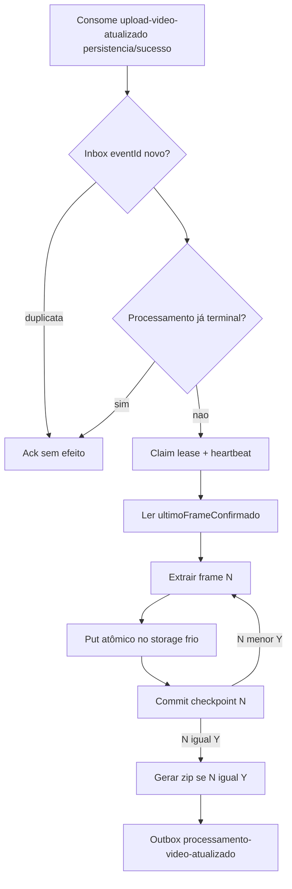

# ADR 004: Split api/worker e checkpoint/retomada

**Data:** 20 de novembro de 2026  
**Status:** Aceito  
**Autores:** Victor Costa

## 1. Contexto e Problema

O processamento usa FFmpeg e grava muitos objetos. O pod pode cair no meio (ex. frame 300 de 1000). Consultas de progresso e URL do zip não devem competir com o worker ocupado ([RNF11](../especificacao/03_requisitos-nao-funcionais.md), [RNF12](../especificacao/03_requisitos-nao-funcionais.md)).

O problema a ser resolvido é: **Como separar HTTP de trabalho pesado e retomar o processamento sem perder frames já gravados?**

## 2. Decisão

- **Dois deployments** no mesmo bounded context: `processamento-api` (progresso, cancelamento, URL do zip) e `processamento-worker` (consumo Pub/Sub, FFmpeg, mídia, checkpoint, publicação de status).
- **Dois planos:**
  - **Controle** no PostgreSQL de `processamento`: status, total estimado, `ultimoFrameConfirmado`, tentativas, lease/owner, inbox, outbox.
  - **Mídia** no frio de `processamento`: frames e zip com **chaves determinísticas** ([ADR 001](001-storage-multi-tier.md)).
- **Idempotência:** inbox (`eventId`) + objetos determinísticos + checkpoint + outbox na conclusão ([ADR 003](003-outbox-inbox.md)).
- **Lease/heartbeat:** o worker renova lease; lease expirado permite reclaim/retomada.
- **Ordem por frame:** gravar objeto no frio → só então commit do checkpoint. Retomada lê `ultimoFrameConfirmado` e continua; objeto já existente no índice é tratado como idempotente.
- **Zip** só com todos os índices presentes; chave estável; regenera se ausente/parcial.
- **Conclusão:** na mesma transação do status terminal, outbox de `processamento-video-atualizado` (`sucesso` / `falha` / `cancelado`).
- **DLQ + max attempts:** esgota tentativas → falha de domínio + evento `falha` (sem loop infinito).
- **Granularidade do checkpoint** (cada frame vs a cada N): **não** fechada neste ADR — decisão na implementação de `processamento` (§10 do checklist). O ADR exige apenas checkpoint **periódico e configurável** após objetos confirmados no frio.

## 3. Justificativa

- API leve atende o `bff` sem bloquear no FFmpeg.
- Frames no frio sobrevivem à morte do pod; Postgres só guarda o cursor.
- Chaves determinísticas tornam reentrega e retomada seguras.

## 4. Alternativas Consideradas

- **Monólito api+worker no mesmo processo:** menos ops; HTTP sofre com CPU do FFmpeg.
- **Só Postgres (sem mídia durável por frame):** perde trabalho ao cair o pod.
- **Checkpoint só em memória/Redis do worker:** volatilidade; viola a fonte canônica em Postgres.

## 5. Consequências

### Positivas

- Retomada após crash sem reextrair o prefixo já confirmado.
- Separação clara de papéis HTTP vs batch.

### Negativas / Riscos (Mitigações)

- **Dois deploys e dois contratos de health/IAM.**
  - *Mitigação:* mesmo repo `processamento-service`, Dockerfiles/k8s distintos.
- **Objetos órfãos se cair entre put e checkpoint.**
  - *Mitigação:* na retomada, reconciliar existência do objeto no índice seguinte.

## 6. Fluxo de retomada

