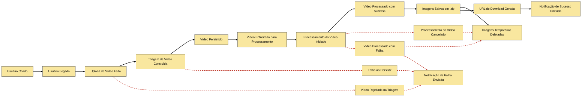

# Linha do tempo de eventos

Transcrição de [`02_linha-do-tempo-eventos.jpg`](02_linha-do-tempo-eventos.jpg).

Caminho feliz: setas pretas. Exceções: setas vermelhas tracejadas.

## Mermaid

## Arestas

### Feliz
- Usuário Criado → Usuário Logado
- Usuário Logado → Upload de Vídeo Feito
- Upload de Vídeo Feito → Triagem de Vídeo Concluída
- Triagem de Vídeo Concluída → Vídeo Persistido
- Vídeo Persistido → Vídeo Enfileirado para Processamento
- Vídeo Enfileirado para Processamento → Processamento do Vídeo Iniciado
- Processamento do Vídeo Iniciado → Vídeo Processado com Sucesso
- Vídeo Processado com Sucesso → Imagens Salvas em .zip
- Imagens Salvas em .zip → Imagens Temporárias Deletadas *(em paralelo com URL)*
- Imagens Salvas em .zip → URL de Download Gerada *(em paralelo com delete temp)*
- URL de Download Gerada → Notificação de Sucesso Enviada

### Exceção
- Upload de Vídeo Feito → Vídeo Rejeitado na Triagem → Notificação de Falha Enviada
- Triagem de Vídeo Concluída → Falha ao Persistir → Notificação de Falha Enviada
- Processamento do Vídeo Iniciado → Processamento do Vídeo Cancelado → Imagens Temporárias Deletadas  
  *(cancelamento **não** gera notificação)*
- Processamento do Vídeo Iniciado → Vídeo Processado com Falha → Imagens Temporárias Deletadas
- Vídeo Processado com Falha → Notificação de Falha Enviada
